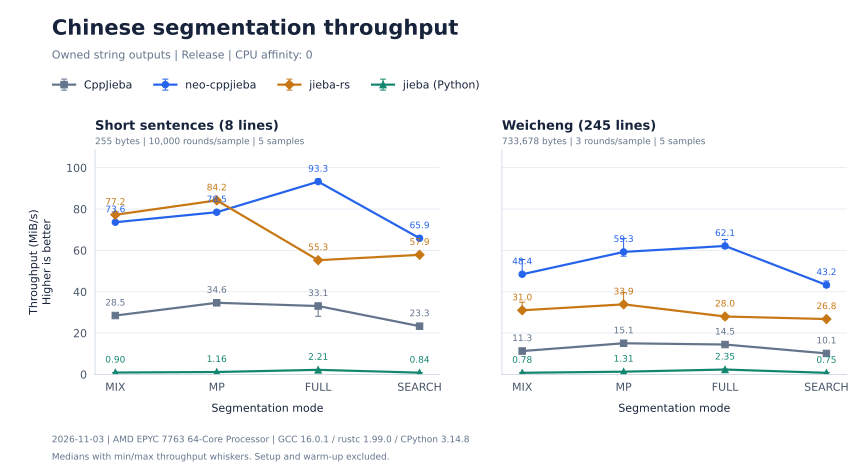

# neo-cppjieba

[](https://github.com/AkrinW/neo-cppjieba/actions/workflows/cmake.yml)
[](https://github.com/AkrinW/neo-cppjieba/actions/workflows/quality.yml)
[](LICENSE)

C++23 中文分词与关键词提取库，以头文件形式提供。分词和关键词结果与 [CppJieba](https://github.com/yanyiwu/cppjieba)
一致，吞吐是它的 2.5–4 倍；另有稳定的 C ABI，方便其他语言绑定。

- **分词**：MIX、MP、HMM、FULL、SEARCH 五种模式，支持用户词典、词性标注和运行时增删词。
- **关键词**：TF-IDF 和 TextRank，分数与 CppJieba 逐位一致，可按词性筛选。
- **输入输出**：接受 UTF-8、UTF-16、UTF-32；结果给出原文位置和码点位置，可以引用原文、持有原文或返回独立字符串。
- **加载**：词典和模型可从文件或内存读取；预编译快照把内置词典的加载时间从约 85 ms 缩短到约 19 ms。
- **兼容**：编译期切换 CppJieba、jieba-rs 或 Python jieba 的分词规则；可选 ICU 适配器处理 GBK / GB18030。

[C++ 使用指南](docs/usage.md) · [构建与安装](docs/building.md) · [C ABI](api/README.md) ·
[应用示例](examples/README.md) · [编码转换](docs/encoding.md) · [更新记录](CHANGELOG.md)

> **2.0.0** 新增词性标注、关键词提取、内存与快照加载、运行时增删词，C ABI 同步扩展。
> C++ 接口有不兼容调整，升级前请阅读 [发布说明](CHANGELOG.md#200---2026-11-03)。

## 快速开始

需要 CMake 3.20+ 和支持 C++23 的编译器。CI 测试 GCC 16、LLVM 23 / libc++ 和 Visual Studio 2026，
详见 [构建环境](docs/building.md#环境)。

```sh
git clone https://github.com/AkrinW/neo-cppjieba.git
cd neo-cppjieba
cmake -S . -B build -DCMAKE_BUILD_TYPE=Release \
  -DBUILD_TESTING=OFF -DCPPJIEBA_BUILD_EXAMPLES=ON
cmake --build build --config Release --target jieba_basic_cut --parallel
./build/examples/jieba_basic_cut dict "我来到北京清华大学"
```

使用 Visual Studio 生成器时，程序位于 `build/examples/Release/jieba_basic_cut.exe`。

### 在代码中使用

```cpp
#include "neo/Jieba.hpp"

#include <print>

// Segment text with explicit dictionary and model paths.
int main() {
    const auto jieba = neo_cppjieba::Jieba{
        "dict/jieba.dict.utf8", "dict/hmm_model.utf8", "dict/user.dict.utf8"};
    for (const auto token : jieba.cut("我来到北京清华大学", neo_cppjieba::CutMode::MIX)) {
        std::println("{}", token.word);
    }
}
```

在仓库根目录运行，输出：

```text
我
来到
北京
清华大学
```

构造参数依次是主词典、HMM 模型和用户词典的路径，用户词典可传 `""`。
程序部署时需要带上这些数据文件，格式见 [词典说明](dict/README.md)。

### 接入 CMake 项目

作为子目录：

```cmake
add_subdirectory(external/neo-cppjieba)
target_link_libraries(my_app PRIVATE neo_cppjieba::neo_cppjieba)
```

或安装后通过 `find_package` 使用，安装前缀加入 `CMAKE_PREFIX_PATH`：

```cmake
find_package(neo_cppjieba 2.0 CONFIG REQUIRED)
target_link_libraries(my_app PRIVATE neo_cppjieba::neo_cppjieba)
```

安装命令、ICU 组件和全部构建选项见 [构建指南](docs/building.md)，C 程序接入见 [C ABI 指南](api/README.md)。

## 选择输出形式

| 入口 | 结果 | 适合 |
| --- | --- | --- |
| `cut` | 引用原文的 token，原文需在使用期间保持有效 | 即时处理，零拷贝 |
| `cut_owned` | 结果自带一份原文 | 保存结果，或输入是临时字符串 |
| `cut_strings` | 每个词一个独立字符串 | 交给其他模块继续处理 |
| `cut_into` / `cut_each` | 写入调用方的数组 / 逐词回调 | 批量处理，配合 `Workspace` 复用内存 |

各入口都支持全部 [分词模式](docs/usage.md#分词模式)；位置坐标、工作区和容量配置见
[C++ 使用指南](docs/usage.md#位置与工作区)。

## 性能对比

同一词典和模型下，neo-cppjieba 的吞吐是 CppJieba 的 2.5–4 倍；短文本与 jieba-rs 相当，长文本快约 1.5 倍。
GitHub 托管 runner 的硬件不固定，不同次测量的绝对数值可能相差一倍，同一次测量内的相对比例更有参考价值。

<!-- benchmark:start -->

数据来自 [GitHub Actions](https://github.com/AkrinW/neo-cppjieba/actions/runs/41558750011)，测试日期：2026-11-03。
测量提交：[`c4bc51c`](https://github.com/AkrinW/neo-cppjieba/commit/c4bc51caf3119f324013090507adbeb1addef925)。
各实现使用同一主词典和 HMM 模型，关闭用户词典；neo-cppjieba 使用 `CPP` 规则。



吞吐量单位为 MiB/s，越高越好。曲线取各样本的中位数，误差线表示最小、最大吞吐量。
各路径均返回独立字符串，计时覆盖分词、字符串构造和释放；语料读取、词典加载和预热在计时前完成。

- 环境：GitHub 托管 `ubuntu-26.04`，AMD EPYC 7763 64-Core Processor，绑定 CPU 0。
- 工具链：GCC 16.0.1（`-O3 -DNDEBUG`）、rustc 1.99.0（`opt-level=3`）、CPython 3.14.8。
- 比较版本：jieba-rs 0.11.0、Python jieba 0.42.1。
- 语料 `testlines`：8 行、255 字节，每样本 10,000 轮，共 5 个样本。
- 语料 `weicheng`：245 行、733,678 字节，每样本 3 轮，共 5 个样本。

不同实现的分词规则存在差异，词序列差异计数保存在数据快照中。
共享 runner 的耗时会有波动，图表仅代表这次测量。

[测试数据](docs/benchmarks/snapshot.json) · [复现与 CI 更新方法](benchmark/README.md)

<!-- benchmark:end -->

## 参与开发

[构建与测试](docs/building.md#测试) · [依赖和离线配置](deps/README.md) ·
[性能测量](benchmark/README.md) · [仓库布局](docs/building.md#仓库布局) · [路线图](ROADMAP.md)

欢迎通过 issue 讨论功能和优先级。

## 致谢与许可证

本项目基于 [CppJieba](https://github.com/yanyiwu/cppjieba) 重写，分词规则参考了 [jieba](https://github.com/fxsjy/jieba)
和 [jieba-rs](https://github.com/messense/jieba-rs)。代码以 [MIT License](LICENSE) 发布；
内置的 GTL 哈希表沿用其 [Apache-2.0 许可证](include/neo/third_party/gtl/LICENSE)。
